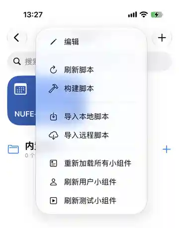
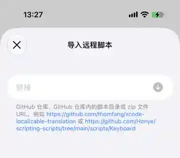
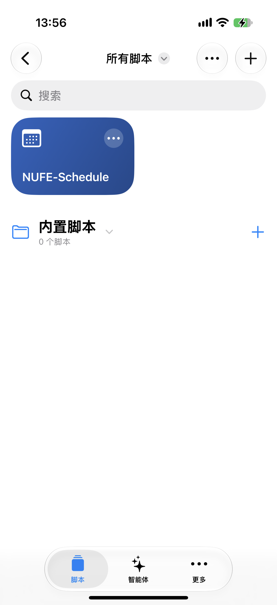
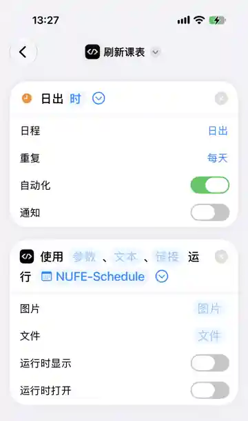
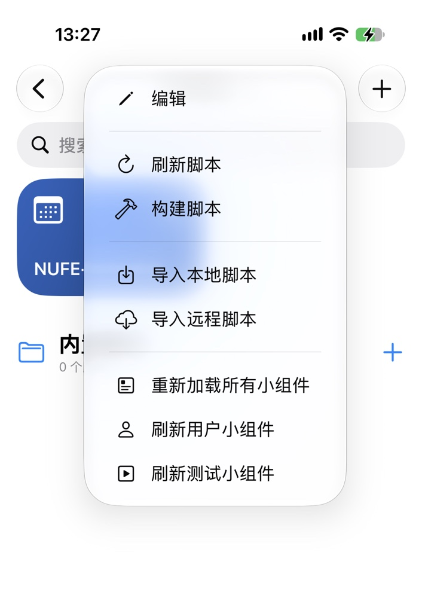

# NUFE-Schedule

## 项目介绍

**NUFE-Schedule** 是一款运行在 iPhone 上的 NUFE 课表同步工具。通过 [Scripting](https://scriptingapp.github.io/) 从学校教务系统读取课程，更新到 Apple 日历，并提供可添加到主屏幕的四日课表小组件。无需部署服务器，也不需要电脑常驻运行。

- **自动维护课程**：同步多个学期，更新新增、调整或取消的课程，并保留本地备份和中断恢复记录。
- **专用日历**：首次使用可创建自定义名称的 iCloud 日历；后续按日历 ID 识别，改名不影响同步。
- **主屏幕课表**：固定显示「昨天、今天、明天、后天」，包含课程名、时间、教室与教师；已结束变灰、正在进行高亮，未显示课程用「+N节课」提示。
- **快捷指令自动化**：支持定时刷新，避免多个任务同时修改日历；手动刷新显示当前阶段。
- **本地认证**：学校登录由设备直接发起，成功认证后自动保存凭据至 iCloud 可同步钥匙串；Cookie 保存在本机。

> **非官方开源项目**，与 NUFE 无官方隶属关系。专用课表日历不应混放私人事项。学校接口、登录验证和 iOS 后台调度可能影响同步或小组件的更新时机。

## 用户指南

### 1. 安装

1. 在 iPhone 安装并打开 [Scripting](https://scriptingapp.github.io/)；点击右上角「＋」并选择「导入远程脚本」。

   <a href="docs/images/scripting-import-menu.webp"></a>

2. 在链接输入框粘贴下面的 **Release 安装包**地址并导入（请勿使用仓库源码 ZIP）：

   ```text
   https://github.com/b7f2d/NUFE-Schedule/releases/download/stable/NUFE-Schedule.zip
   ```

   <a href="docs/images/scripting-remote-zip.webp"></a>

3. 返回 Scripting 主界面，**点击 NUFE-Schedule 项目卡片**运行。

   <a href="docs/images/scripting-project-card.webp"></a>

### 2. 首次登录与日历同步

1. 根据提示授权日历访问。首次使用时输入喜欢的名称，脚本会尝试创建**独立的 iCloud 日历**并核验来源。日历名称不必包含「课表」；以后在 Apple 日历改名也不会影响绑定。
2. 输入 NUFE 账号、密码，按学校要求完成短信、验证码或其他验证。学校确认登录成功后，凭据会自动保存到 iCloud 可同步钥匙串，以供 Cookie 失效时重新认证。
3. 点击 **「立即刷新」**，程序会获取课程并同步到绑定的日历。第一次可能需要导入多个历史学期，因此比日常刷新慢；手动操作时可看到当前同步阶段。
4. 打开 Apple 日历，核对课程日期、上课时间、教师和教室，尤其是首次导入后的第一教学周。

**关于日历安全：** NUFE-Schedule 只认已绑定的日历 ID，不会根据同名日历自动切换。原日历不可见时，前台运行才会提示重新指定或新建；自动化不会擅自接管其他日历。专用日历可能清理旧事件，**请勿在里面保存私人日程**。

### 3. 添加主屏幕课表

1. 先在 NUFE-Schedule 中成功同步至少一次，然后点击项目打开主菜单，使组件缓存更新。
2. 在 iPhone 主屏幕长按空白区域，添加 **Scripting** 小组件；建议优先试用大尺寸。
3. 长按小组件 →「编辑小组件」→ 将脚本选择为 **NUFE-Schedule**。

> **临时组件测试模式：2024-2025-2。** 当前仅桌面组件使用此学期的真实历史课程，选择课程较丰富的一周，按原星期与时间映射到当前四天。Apple 日历与正常课表同步仍使用真实日期。若本地缺少该学期历史课表，先手动同步全部学期再打开主项目刷新小组件缓存。

中、大尺寸直接显示放大的「昨天、今天、明天、后天」；**今天有两节及以上时占两个课程卡片位**，并排显示正在上或下一节及其后续一节，剩余课程在第二节下方标「+N节课」。今天只有一节课时，四天仍均匀分列。小尺寸突出「今天」和课程内容。每节课采用有色卡片：已结束为浅灰、正在上课为浅蓝、尚未开始为淡蓝灰，组件整体底色是白色。卡片内显示课程名称、上课时间、教室与教师；如果当天课程太多，末尾显示「+N节课」，不自动跳过前面的课程。

组件读取项目本地缓存，**不为展示课程重新登录或修改 Apple 日历**。在课程开始、结束或日期切换时会向 iOS 申请更新，但主屏幕小组件的实际刷新时间由系统决定，可能延迟。

### 4. 设置快捷指令自动刷新

1. 打开 iOS **「快捷指令」→「自动化」**，新增个人自动化，选择每日固定时间、日出等触发条件，并设为「立即运行」。
2. 添加 Scripting 的运行脚本操作，指定 **NUFE-Schedule**；无需填写额外文件或参数。
3. 保存后先手动执行一次，确认能够完成同步。可以按自己的需要减少自动化通知及运行时界面。

   <a href="docs/images/shortcuts-automation.webp"></a>

> iOS 可能推迟或取消后台执行；学校需要交互验证码时，仍须在 Scripting 内完成验证。自动化任务不会弹出手动刷新进度窗口。

### 5. 日常使用与更新

点击 NUFE-Schedule，主菜单只保留 **「立即刷新」「自动登录凭据」「运行状态」**。

- **立即刷新**：一次拉取并核验学校列出的全部可用学期，显示实际进度阶段，不使用虚假的百分比；首次导入或课程多时可能较久。
- **自动登录凭据**：查看脱敏账号、更新或删除保存的账号密码。
- **运行状态**：了解最近同步结果和必要的异常提醒；遇到问题时使用「环境自检」，它会检查日历绑定、登录会话、存储及学校连接，不会改动课程。

如遇到另一项同步正在运行，可以等待完成，或请求前次任务在安全检查点退出。对于已失联的任务，程序会在确认锁失去活动后尝试恢复，不会直接强制终止 iOS 进程。

**更新脚本**：在 Scripting 主界面点击 NUFE-Schedule 卡片右上角「···」→「远程资源」→ **「立即更新」**，再点击项目打开。所有更新使用同一份 Release ZIP，无需重新创建日历或重新导入项目。

<a href="docs/images/scripting-refresh-menu.webp"></a>

### 6. 常见问题

| 现象 | 建议处理 |
| --- | --- |
| 桌面组件没有课程或仍显示旧内容 | 先在 Scripting 更新远程资源，点击 NUFE-Schedule 打开一次；确认已成功同步。如仍不显示，可重新添加小组件。 |
| 小组件的上下课颜色没有立刻变化 | WidgetKit 的刷新时间由 iOS 调度，通常不是秒级；无需重复登录。 |
| 刷新缓慢或提示已有同步任务 | 首次导入历史学期可能较慢。已有任务时优先等待；如已失去响应，可按提示申请安全取消与恢复。 |
| Cookie 过期、需要验证码 | 进入 NUFE-Schedule 手动刷新，按校方认证页面完成验证；自动登录的有效期由学校决定。 |
| 绑定日历找不到 | 前台执行「立即刷新」，根据提示重新指定原日历或创建新的 iCloud 日历；不要自行删除原日历。 |
| 无法创建 iCloud 日历 | 确认 Apple 日历已开启 iCloud 日历，按程序提示核实账户来源；程序不会悄悄改用其他账户。 |
| 出现具体错误代码 | 记录错误代码或截图，检查「运行状态 → 环境自检」；错误提示不会包含密码和 Cookie。 |

如需反馈问题，请附上现象、是否在前台或快捷指令运行、错误代码和必要的脱敏截图，**不要公开学号、密码、Cookie 或教务系统会话信息**。
